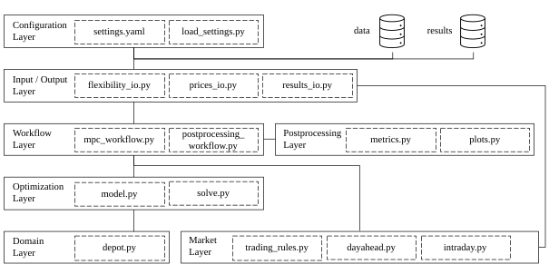
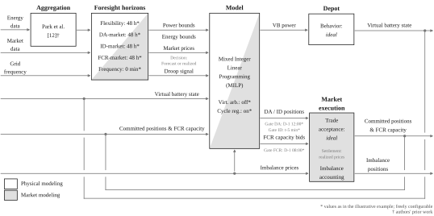

<p align="center">
  <br>
  <a href="https://github.com/TUMFTM/flex-depot/actions/workflows/test.yml"></a>&nbsp;<a href="https://www.apache.org/licenses/LICENSE-2.0"></a>&nbsp;<a href="https://doi.org/10.5281/zenodo.21529546"></a>&nbsp;<a href="https://codeocean.com/capsule/2663838"></a>
</p>

<p align="center">
  <em>The Code Ocean capsule runs the quick-start configuration as a reproducible example.</em>
</p>

**FLEX-DEPOT** is a Python project for optimizing flexibility at a logistics depot incorporating electric trucks. It combines market
price series, flexibility power and energy bands, and market trading rules into a single rolling-horizon optimization (MPC). 
The core of the project is a MILP/LP (depending on settings) [Pyomo](https://pyomo.readthedocs.io/en/stable/) model that decides market
positions and physical power flow between depot and public grid while respecting aggregated asset power and energy flexibility bounds and gate-closure rules.

Key capabilities:
- Unified optimization for DA/ID spot markets and FCR reserve market.
- Rolling-horizon MPC that commits market positions when gate closure is reached.
- Optional imbalance settlement (reBAP) as a feasibility fallback.
- CSV-based I/O for prices, flexibility bounds, and results.
- Plotly-based visualization of dispatch, prices, and cashflows.

## Created by
Marcel Brödel, M.Sc. <br>
Institute of Automotive Technology <br>
Department of Mobility Systems Engineering <br>
TUM School of Engineering and Design <br>
Technical University of Munich <br>
[marcel.broedel@tum.de](mailto:marcel.broedel@tum.de)

### Contributors
Tien Doan, B.Sc. - Master's student <br>
Adrian Simon Würth, B.Sc. - Master's student <br>
Woan-Ho Park, M.Sc. - Visiting research associate <br>
Philipp Rosner, M.Sc. - Research associate <br>
Roman Schade, M.Sc. - Master's student <br>
Rishabh Rai, B.Sc. - Bachelor's student <br>
Wurilege Wurilege, M.Sc. - Master's student <br>

## Licensing
FLEX-DEPOT is licensed under the [Apache 2.0](https://www.apache.org/licenses/LICENSE-2.0) open source license. <br>
The full license text can be found in the LICENSE file in the root directory of the repository.

## Related Publications
Brödel, M., Würth, A.S., Park, W.-H., Rosner, P., Lienkamp, M.: "FLEX-DEPOT: An open-source framework for multi-market flexibility commercialization of a logistics depot incorporating electric trucks." <br>
Manuscript in preperation

Park, W.-H., Brödel, M., Rosner, P., Kim, Y.-S.: "Scalable EV Flexibility Aggregation with Guaranteed Disaggregation via Fast Projection onto Reachable Sets: Application to Real Truck Fleet Data" <br>
Manuscript in revision at eTransportation, Elsevier (2026)

## Citation
If you use FLEX-DEPOT in academic work, please cite **both**:
1. The FLEX-DEPOT software repository
2. The associated publication

**Software:**
Brödel, M. (2026). FLEX-DEPOT (Version 2.0.1). GitHub repository.  
https://github.com/TUMFTM/flex-depot

**Publication:**
Brödel, M., Würth, A.S., Park, W.-H., Rosner, P., Lienkamp, M.  
*FLEX-DEPOT: An open-source framework for multi-market flexibility commercialization of a logistics depot incorporating electric trucks.*  
In preparation.

Citation metadata is provided in `CITATION.cff`.

## Repository Architecture




## Module Description
`Configuration Layer` specifies all scenario settings, including simulation horizons, enabled markets, optimization options, and asset parameters, serving as the single entry point.

`Input/Output Layer` manages the ingestion, alignment, and validation of external time series data, such as market prices and depot-based flexibility bands, as well as the structured export of results.

`Workflow Layer` coordinates execution across time and market stages, handling repeated optimizations, market gate closures, and progressive commitment of decisions.

`Optimization Layer` contains the mathematical formulation and solver interface that convert aggregated flexibility into market positions and operational schedules under market and physical constraints.

`Domain Layer` includes domain (depot)-specific abstractions.

`Market Layer` defines market and trading rules such as gate-closures.

`Postprocessing Layer` includes result summary generation and a plotting script.

## Control Workflow


## Installation
### 1) Clone repository
FLEX-DEPOT is available on [GitHub](https://github.com/TUMFTM/flex-depot) and can be cloned from there using
```
git clone https://github.com/TUMFTM/flex-depot
```

### 2) Create and activate a virtual environment
Recommendation: It is recommended to create and activate a clean virtual environment for the installation in the local `.venv/` directory. For Windows (PowerShell) the environment set up can be done by the following commands:
```
cd <root_directory>
py -m venv .venv
.\.venv\Scripts\activate
```
Alternative: A self-defined environment can also be set up (in this case do not forget to add `<name_of_virtual_environment>` to `.gitignore`):
```
py -m venv <name_of_virtual_environment>
.\<name_of_virtual_environment>\Scripts\activate
```
or alternatively using conda: 
```
conda create -n <name_of_conda_environment> python=3.11
conda activate <name_of_conda_environment>
```

### 3) Install the package
Install the package and its dependencies using pip:
```
python -m pip install --upgrade pip
pip install -e .
```

### 4) Solver
FLEX-DEPOT uses [Pyomo](https://pyomo.readthedocs.io/en/stable/) as the modelling interface. The open-source solver [HiGHS](https://highs.dev/) is included as a core dependency and requires no additional installation — `pip install -e .` is sufficient.

To verify that HiGHS is available:
```
python -c "import pyomo.environ as pyo; print(pyo.SolverFactory('appsi_highs').available())"
```

Optionally, the proprietary [Gurobi](https://www.gurobi.com/) solver can be used instead (faster for large problems, free academic license available). Install the Python bindings and set `solver = "gurobi"` in the TOML config:
```
pip install gurobipy==<your_gurobi_version>
```

### 5) Quick start (recommended)
The repository contains a ready-to-run quick-start script for Windows:
```
.\run_quickstart.bat
```
Or the unix shell script for Linux/macOS:
```
bash run_quickstart.sh
```
These commands will run the quick-start configuration and generate result files in the results/ directory.

### Illustrative example (paper scenarios)
Four ready-made scenario configurations of increasing capability (S1: DA only → S4: DA+ID+FCR with
imperfect price foresight) reproduce the illustrative example of the paper over a one-month window;
the quick-start example above is its 4-day detail window. See
[examples/illustrative_example/](examples/illustrative_example/) for the scenario definitions,
`run_all.sh` / `run_all.bat` (sequential execution + aggregated comparison table in
`results/illustrative_example/`), and the paper figure scripts (`pip install -e .[paper]` for
matplotlib).


## How to use
Installing the package provides the console command ```flex-depot``` (equivalently
```python -m flex_dep_opt```) with three subcommands, defined in ```cli.py```:
1. Running the simulation by ```flex-depot run-sim --config <settings.toml_file_path>```
2. Running the postprocessing by ```flex-depot run-post --config <settings.toml_file_path>```
3. Running a scenario batch by ```flex-depot run-batch <configs_dir>```: executes
   simulation + postprocessing for every ```*.toml``` in the directory (in parallel,
   ```--jobs <n>```, default: all CPU cores) and writes a KPI manifest CSV
   (```--manifest <path>```, default: ```results/batches/<batch>__<timestamp>/manifest.csv```).
   If the directory contains a ```default.toml```, each config is deep-merged onto it,
   so per-run TOMLs only need to state the parameters that differ.

```run-sim``` and ```run-post``` accept an optional ```--run-dir <directory>``` to write to / read from a fixed run
directory instead of the default timestamped ```results/<name>__<timestamp>/```. If ```--config``` is
omitted, ```run-sim``` uses the bundled ```settings_quickstart.toml``` and ```run-post``` postprocesses the
latest run (from ```results/LATEST.txt```).

Note: data paths inside the TOML configs are resolved relative to the current working
directory — run the commands from the repository root (as ```run_quickstart.bat``` / ```run_quickstart.sh``` do).

### Python API
The same workflow is available from Python, with all results as pandas objects in memory:
```python
import flex_dep_opt as fd

settings = fd.Settings.from_toml("src/flex_dep_opt/config/settings_quickstart.toml")
inputs = fd.load_inputs(settings)            # price series, flexibility bounds, FCR data
result = fd.simulate(settings, inputs)       # result.dispatch, result.commits, result.fcr_commits
evaluation = fd.evaluate(result)             # evaluation.kpis, evaluation.cashflows, Plotly figures

result.save("results/my_run")                # same files as run-sim
evaluation.save("results/my_run")            # same files as run-post
```
Settings can be changed in Python before a run (e.g. `settings.simulation.end = ...`).
`fd.SimulationResult.load(run_dir)` reads a saved run back, and `fd.run_batch(configs_dir)` runs a
scenario batch like `run-batch` and returns the manifest as a DataFrame. An infeasible MPC step raises
`fd.SimulationError`, which carries the steps solved so far in `partial_result`. Status messages are
emitted through `logging` and are silent by default; the example shows how to switch them on.
A runnable version is [examples/python_api.py](examples/python_api.py).

Within the TOML file all parameters for a simulation run can be set: 

The tables below are generated from the settings model in `src/flex_dep_opt/config/settings.py`.
After changing a parameter there, run `python scripts/generate_config_reference.py` to update them.

<!-- config-reference:start (generated by scripts/generate_config_reference.py, do not edit) -->

**`simulation`**: Time window, run name and solver.

| Parameter | Type | Default | Description |
|---|---|---|---|
| `simulation.start` | datetime | required | Simulation start time (inclusive), format `YYYY-MM-DD HH:MM`. |
| `simulation.end` | datetime | required | Simulation end time (inclusive), format `YYYY-MM-DD HH:MM`. |
| `simulation.timestep_hours` | float | `0.25` | Simulation timestep in hours. Only 0.25 is tested. |
| `simulation.name` | str | `"example_simulation"` | Identifier used for naming result files. |
| `simulation.solver` | `cbc` / `gurobi` / `highs` | `"highs"` | Optimization solver backend. |
| `simulation.solver_threads` | int, optional | `8` | Solver thread count. Set 1 for batch runs that parallelize across scenarios (`--jobs`). |
| `simulation.solver_mip_gap` | float, optional | unset | Relative MIP gap termination criterion. Unset uses the solver default. |
| `simulation.solver_time_limit_s` | int, optional | unset | Solver time limit per optimization in seconds. Unset means no limit. |
| `simulation.solver_tee` | bool | `false` | Stream solver output to stdout. Useful to diagnose hangs or slow solves. |
| `simulation.warmup_hours` | float (≥ 0) | `0.0` | Warm-up lead-in before the reporting window in hours. The MPC starts `warmup_hours` before `simulation.start`, so positions whose gate closes before the reporting start (e.g. the first delivery day's day-ahead auction, closing on D-1) are committed on a full horizon instead of defaulting to zero. Warm-up steps advance the state (SoC, committed positions) but are excluded from all results and KPIs. Input series must cover `start - warmup_hours`. Set above the day-ahead gate lead (more than about 12 h; at least about 40 h when FCR is enabled). 0 disables warm-up. |

**`optimization`**: Markets, trading rules, MPC and depot model.

| Parameter | Type | Default | Description |
|---|---|---|---|
| `optimization.virtual_arbitrage` | bool | required | Allow offsetting buy and sell positions across markets. |

**`optimization.markets`**: Energy markets and their price sources.

| Parameter | Type | Default | Description |
|---|---|---|---|
| `optimization.markets.dayahead.enabled` | bool | `false` | Enable participation in this market. |
| `optimization.markets.dayahead.source` | str | required | CSV file with the realized price time series, used for settlement. |
| `optimization.markets.dayahead.forecast_source` | str, optional | unset | Optional CSV with a price forecast used for MPC decisions. If omitted, realized prices are used (perfect foresight, upper-bound potential). Settlement always uses `source`. |
| `optimization.markets.dayahead.fee_eur_per_kwh` | float | required | Transaction fee applied to trades on this market in €/kWh. |
| `optimization.markets.dayahead.forecast_error.enabled` | bool | `false` | Let the MPC decide on a synthetically perturbed price series (realized price plus an AR(1) error) while cashflows are settled on the realized prices. |
| `optimization.markets.dayahead.forecast_error.sigma_eur_per_mwh` | float (≥ 0) | `0.0` | Standard deviation of the forecast error in €/MWh. |
| `optimization.markets.dayahead.forecast_error.rho` | float (≥ 0, < 1) | `0.944` | Lag-1 autocorrelation of the forecast error per 15-minute step. |
| `optimization.markets.dayahead.forecast_error.seed` | int | `1` | Random seed of the forecast-error series. |
| `optimization.markets.intraday.enabled` | bool | `false` | Enable participation in this market. |
| `optimization.markets.intraday.source` | str | required | CSV file with the realized price time series, used for settlement. |
| `optimization.markets.intraday.forecast_source` | str, optional | unset | Optional CSV with a price forecast used for MPC decisions. If omitted, realized prices are used (perfect foresight, upper-bound potential). Settlement always uses `source`. |
| `optimization.markets.intraday.fee_eur_per_kwh` | float | required | Transaction fee applied to trades on this market in €/kWh. |
| `optimization.markets.intraday.forecast_error.enabled` | bool | `false` | Let the MPC decide on a synthetically perturbed price series (realized price plus an AR(1) error) while cashflows are settled on the realized prices. |
| `optimization.markets.intraday.forecast_error.sigma_eur_per_mwh` | float (≥ 0) | `0.0` | Standard deviation of the forecast error in €/MWh. |
| `optimization.markets.intraday.forecast_error.rho` | float (≥ 0, < 1) | `0.944` | Lag-1 autocorrelation of the forecast error per 15-minute step. |
| `optimization.markets.intraday.forecast_error.seed` | int | `1` | Random seed of the forecast-error series. |

**`optimization.trading`**: Gate closure rules and the FCR reserve market.

| Parameter | Type | Default | Description |
|---|---|---|---|
| `optimization.trading.mode` | `none` / `realistic` | `"none"` | Trading mode. `none` keeps the day-ahead and intraday markets always open; `realistic` enforces gate closures. |
| `optimization.trading.dayahead.gate_closure_hour` | str | `"12:00"` | Day-ahead gate closure time, format `HH:MM`. |
| `optimization.trading.dayahead.closes_previous_day` | bool | `true` | Whether the day-ahead gate closes on the day before delivery (D-1). |
| `optimization.trading.intraday.offset_minutes_before_delivery` | int | `30` | Intraday gate closure as minutes before delivery. |
| `optimization.trading.fcr.enabled` | bool | `false` | Enable FCR reserve market participation. |
| `optimization.trading.fcr.prices_source` | str | required | Excel file (.xlsx) with FCR capacity prices, one price per slot. |
| `optimization.trading.fcr.frequency_source` | str, optional | unset | CSV file with the grid frequency time series. |
| `optimization.trading.fcr.breakeven_analysis` | bool | `true` | Report the FCR capacity price at which bidding breaks even. Costs extra diagnostic solves. |
| `optimization.trading.fcr.breakeven_include_zero_bid` | bool | `false` | Include the zero-bid alternative in the break-even analysis. |
| `optimization.trading.fcr.gate_closure_hour` | str | `"08:00"` | FCR gate closure time, format `HH:MM`. |
| `optimization.trading.fcr.gate_closure_closes_previous_day` | bool | `true` | Whether the FCR gate closes on the day before delivery (D-1). |
| `optimization.trading.fcr.gate_closure_timezone` | str | `"Europe/Berlin"` | Timezone in which the FCR gate closure is evaluated. |
| `optimization.trading.fcr.product_hours` | float | `4.0` | Duration of one FCR product slot in hours. |
| `optimization.trading.fcr.bid_block_mw` | float | `1.0` | Minimum bid increment in MW. |
| `optimization.trading.fcr.energy_reserve_minutes` | float | `15.0` | Required energy reserve per MW of FCR capacity, in minutes of full activation. |
| `optimization.trading.fcr.reserve_penalty_eur_per_kwh` | float | `10.0` | Penalty on violating the FCR energy reserve (soft constraint) in €/kWh. |
| `optimization.trading.fcr.balance_penalty_eur_per_kwh` | float | `0.0001` | Soft mid-band pull on the energy state during FCR slots in €/kWh. Keeps distance to the reserve edge. |
| `optimization.trading.fcr.frequency_nominal_hz` | float | `50.0` | Nominal grid frequency in Hz. |
| `optimization.trading.fcr.deadband_hz` | float | `0.01` | Frequency deadband around nominal in Hz. |
| `optimization.trading.fcr.full_activation_hz` | float | `0.2` | Frequency deviation at which FCR is fully activated, in Hz. |

**`optimization.imbalance`**: Imbalance settlement.

| Parameter | Type | Default | Description |
|---|---|---|---|
| `optimization.imbalance.enabled` | bool | `false` | Enable imbalance settlement as a fallback. |
| `optimization.imbalance.source_pos` | str | required | CSV file with positive imbalance prices. |
| `optimization.imbalance.source_neg` | str | required | CSV file with negative imbalance prices. |
| `optimization.imbalance.imbalance_volume_penalty_eur_per_kwh` | float | `1000.0` | Penalty on imbalance energy to discourage its use, in €/kWh. |

**`optimization.mpc`**: Rolling-horizon settings.

| Parameter | Type | Default | Description |
|---|---|---|---|
| `optimization.mpc.da_horizon_hours` | int | required | MPC prediction horizon for day-ahead optimization in hours. |
| `optimization.mpc.id_horizon_hours` | int | required | MPC prediction horizon for intraday optimization in hours. |
| `optimization.mpc.fcr_price_horizon_hours` | int | required | Horizon of known FCR capacity prices ahead of each MPC step in hours. |
| `optimization.mpc.fcr_frequency_horizon_minutes` | int | required | Horizon of known frequency/activation signal inside the MPC window in minutes. 0 means unknown. |
| `optimization.mpc.terminal_condition` | bool | required | Enable the soft terminal energy condition. |
| `optimization.mpc.terminal_weight_eur_per_kwh` | float | required | Weight of the terminal energy deviation penalty in €/kWh. |

**`optimization.flexibility`**: Depot flexibility bands.

| Parameter | Type | Default | Description |
|---|---|---|---|
| `optimization.flexibility.bounds_file` | str | required | CSV file with the aggregated power and energy flexibility bands. |
| `optimization.flexibility.cycle_regularization.enabled` | bool | required | Enable cycling regularization. |
| `optimization.flexibility.cycle_regularization.cost_eur_per_kwh_throughput` | float | required | Cost per charged/discharged energy throughput in €/kWh. |

**`optimization.depot`**: Depot efficiencies and grid connection.

| Parameter | Type | Default | Description |
|---|---|---|---|
| `optimization.depot.eta_grid2depot` | float (> 0, ≤ 1) | required | Efficiency of the grid-to-depot power flow. |
| `optimization.depot.eta_depot2grid` | float (> 0, ≤ 1) | required | Efficiency of the depot-to-grid power flow. |
| `optimization.depot.grid_connection_limit` | float (> 0) | required | Symmetric grid connection limit in kW. |

**`postprocessing`**: What the evaluation step computes and keeps.

| Parameter | Type | Default | Description |
|---|---|---|---|
| `postprocessing.save_commits` | bool | `true` | Keep `commit.csv` and `fcr_commit.csv` after postprocessing. `false` deletes them to save disk space. |
| `postprocessing.reference_driving_energy_costs.enabled` | bool | `false` | Compute the uncontrolled-charging reference cost KPI. |
| `postprocessing.reference_driving_energy_costs.static_price_eur_per_kwh` | float, optional | unset | Static electricity price for the reference cost in €/kWh. Required when enabled. |
| `postprocessing.reference_driving_energy_costs.energy_column` | str | `"Ref_driving_energy_kWh"` | Column in the flexibility CSV with the grid-side reference driving energy in kWh per step. |
| `postprocessing.reference_driving_energy_costs.charging_efficiency` | float (> 0, ≤ 1) | `0.98` | Charging efficiency reported with the reference cost KPIs. It does not enter the cost, because the reference energy column is already grid-side. |

<!-- config-reference:end -->

## Input data formats

All input files must cover the configured simulation horizon (plus the MPC lookahead) at
the simulation timestep. Timestamps must be timezone-aware (e.g. `2026-02-06 00:00:00+01:00`
or UTC); config timestamps (`simulation.start` / `simulation.end`) are interpreted as
`Europe/Berlin` local market time — German market conventions (DA/ID gate closures, FCR 4 h
slots, reBAP) are the modelling baseline.

| Input | Format | Required columns / notes |
|-------|--------|--------------------------|
| DA / ID / imbalance prices | CSV | `time`, `price`. **Prices in €/kWh** (not €/MWh; e.g. 0.06364 = 63.64 €/MWh). One row per simulation timestep; duplicates and gaps raise errors. |
| Price forecasts (optional) | CSV | Same format as the realized price series; used for MPC decisions only, settlement always uses the realized series. |
| Flexibility bounds | CSV | `time`, `Power_lower_kW`, `Power_upper_kW`, `Capacity_lower_kWh`, `Capacity_upper_kWh`; optional `Ref_driving_energy_kWh` (used by the reference-cost postprocessing). |
| FCR capacity prices | XLSX | Column `GERMANY_SETTLEMENTCAPACITY_PRICE_[EUR/MW]` plus either `DATETIME_UTC` or `DATE_FROM` + `PRODUCTNAME` (the format of the German TSOs' tender-result export, regelleistung.net). One price per 4 h product slot, in €/MW. |
| Grid frequency | CSV | `DATETIME` plus the pre-aggregated droop signal `FREQ_DROOP_MEAN` (mean normalized FCR activation in [-1, 1] per timestep); optional `FREQ_DROOP_ABS_MEAN`. |

The bundled files under `data/example/` serve as format references; see
[data/example/README.md](data/example/README.md) for their provenance and terms of use.
